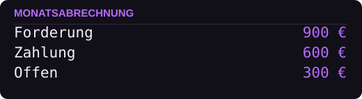
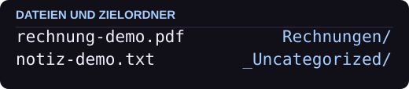
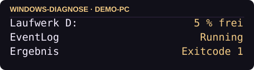

<picture>
  <source media="(prefers-color-scheme: dark)" srcset="./assets/lukowski-dark.svg">
  
</picture>

# Chris L.

Anwendungsentwicklung mit C#/.NET und TypeScript. Ich entwickle Backend-Funktionen mit PostgreSQL und automatisiere wiederkehrende Arbeitsschritte. Die Inhalte meiner Umschulung sind abgeschlossen. Die schriftliche IHK-Abschlussprüfung Teil 2 steht noch aus.

## Projekte

**[Vermietungsverwaltung](https://github.com/rogchris/vermietungsverwaltung)** · Verträge, Forderungen und PDF-Berichte mit Next.js und PostgreSQL.

**[SmartSort](https://github.com/rogchris/smartsort-cli)** · C#-CLI für regelbasierte Dateisortierung, PDF-Text und DryRun.

**[WinCheck](https://github.com/rogchris/wincheck-cli)** · C#-CLI für Windows-Dienste und freien Speicher, mit JSON-Ausgabe und Exitcodes.

**Technik** · C#/.NET · TypeScript/Next.js · PostgreSQL/Prisma · Docker Compose · xUnit, Vitest und Playwright
